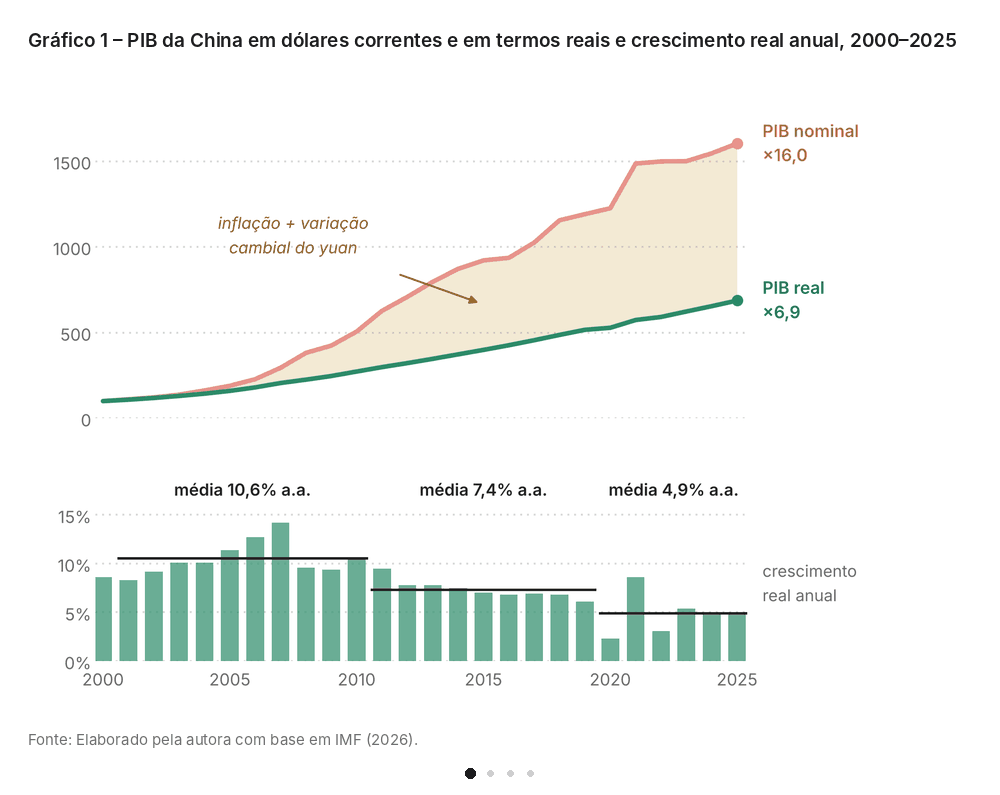

# china-pib-graficos



Scripts e dados utilizados para a geração de quatro gráficos do estudo dirigido de Introdução à Economia (UNESP Assis), sobre o PIB da China e sua posição na economia mundial entre 2000 e 2025.

*English version below.*

## Gráficos

| # | Pergunta | Arquivo |
|---|---|---|
| 1 | Quanto o PIB da China cresceu em dólares correntes (nominal) e em volume (real)? | `figures/grafico1_pib_nominal_e_real.png` |
| 2 | O tamanho da China perto dos EUA muda conforme a medida (PIB total ou per capita, em PPC ou em US$)? | `figures/grafico2_quatro_medidas.png` |
| 3 | A China está seguindo o caminho de Japão, Taiwan e Coreia do Sul na renda por pessoa? | `figures/grafico3_vizinhos_asiaticos.png` |
| 4 | Quantas economias comerciam mais com a China do que com os EUA? | `figures/grafico4_parceiros_comerciais.png` |

## Como rodar

Requisitos: Python 3 e matplotlib.

```bash
git clone https://github.com/devletstahl/china-pib-graficos.git
cd china-pib-graficos
python -m venv .venv && source .venv/bin/activate   # no Windows: .venv\Scripts\activate
pip install -r requirements.txt
python src/make_figures.py
python src/make_carousel.py   # opcional: figures/carrossel.gif
```

O script lê `data/raw/`, grava as séries calculadas em `data/processed/`, gera as imagens em `figures/` e imprime os valores principais (valores esperados em `METHODS.md`).
Os gráficos usam a fonte Inter. Na ausência dela, o matplotlib usa a DejaVu Sans e o layout varia ligeiramente.

## Pastas

```
data/raw/         dados das fontes, sem transformação
data/processed/   séries calculadas pelo script
data/DATA.md      dicionário de colunas, origem e acesso aos dados
src/              make_figures.py (uma função por gráfico) e make_carousel.py (GIF do README)
figures/          imagens PNG (300 dpi) e carrossel.gif
METHODS.md        métodos de cálculo e limitações
```

## De onde vêm os dados

- FMI, *World Economic Outlook* de outubro de 2026 (DataMapper). Source: International Monetary Fund, World Economic Outlook Database, October 2026.
- Bolt e van Zanden, *Maddison Project Database 2023* (via Our World in Data).
- Lowy Institute, *China versus America on global trade*, 2025.

Endereços, datas de acesso, procedimento de acesso a cada fonte e o resultado da conferência de 23 nov. 2026 contra os sites de origem estão em `data/DATA.md`.

## Licenças

- Código (`src/`): MIT (`LICENSE`).
- Figuras e textos: CC BY 4.0 (`LICENSE-FIGURES.md`).
- Dados originais: valem os termos de cada fonte (`data/DATA.md`).

## Como citar

O arquivo `CITATION.cff` faz o GitHub mostrar o botão "Cite this repository".

GÓES, Letícia. *china-pib-graficos: scripts e dados para gráficos sobre o PIB e a posição internacional da China (2000–2025)*. Versão 1.0.0. 2026.

---

## English

Scripts and data used to generate four charts for an introductory economics assignment (UNESP Assis, Brazil) on China's GDP and its position in the world economy, 2000 to 2025. All outputs are rebuilt with a single command. Chart text is in Brazilian Portuguese.

**Charts.** (1) China's nominal vs. real GDP growth. (2) China as a share of US GDP under four measures (total or per capita, PPP or current US$). (3) Per-capita income catch-up of China vs. Japan, Taiwan and South Korea, starting from the 20%-of-US level. (4) Number of economies that trade more with China than with the US.

**Run.** Requirements: Python 3 and matplotlib.

```bash
git clone https://github.com/devletstahl/china-pib-graficos.git
cd china-pib-graficos
python -m venv .venv && source .venv/bin/activate   # on Windows: .venv\Scripts\activate
pip install -r requirements.txt
python src/make_figures.py
python src/make_carousel.py   # optional: figures/carrossel.gif
```

**Data.** IMF *World Economic Outlook* (Oct 2026), Maddison Project Database 2023 (via Our World in Data) and Lowy Institute, *China versus America on global trade* (2025). `data/DATA.md` documents URLs, access dates, access procedures and the check against the live sources on 23 Nov 2026. `METHODS.md` documents the calculations and limitations.

**Licenses.** Code is MIT. Figures and text are CC BY 4.0. Source data keep their own terms.
